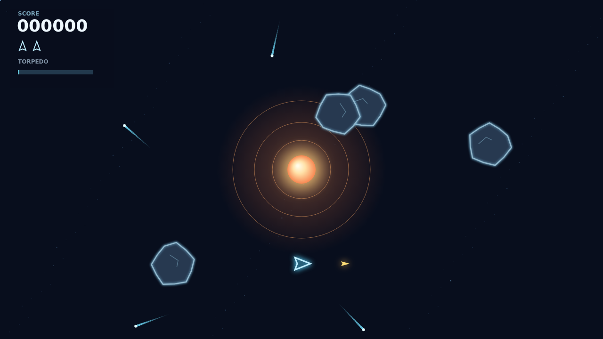

# Shatter

Turn, thrust, and drift through a field of armored rocks. Break each one into smaller fragments, then clear the last splinters to bring on a faster, denser wave.

A bright star holds the centre. It curves your bullets and the rocks around it, opening up surprising shots across the field. Your ship flies free of the pull, and any rock swallowed by the core comes back from an edge.

When the saucer arrives, it hunts you with aimed fire. Save your single guided torpedo for the toughest target: it finds a body in its forward cone, cuts straight through the well, and breaks any rock in one strike. Its charge takes ten seconds to return.
